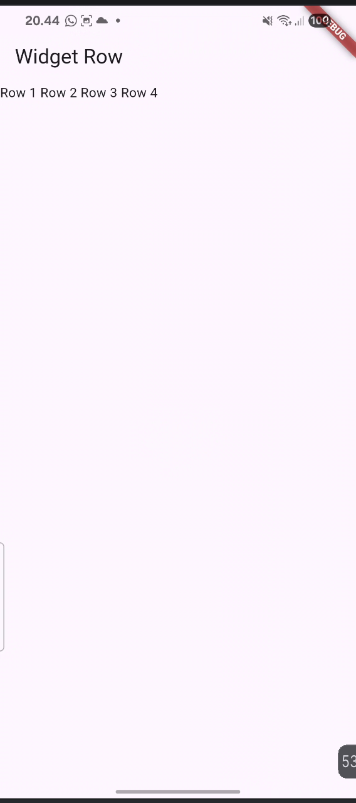
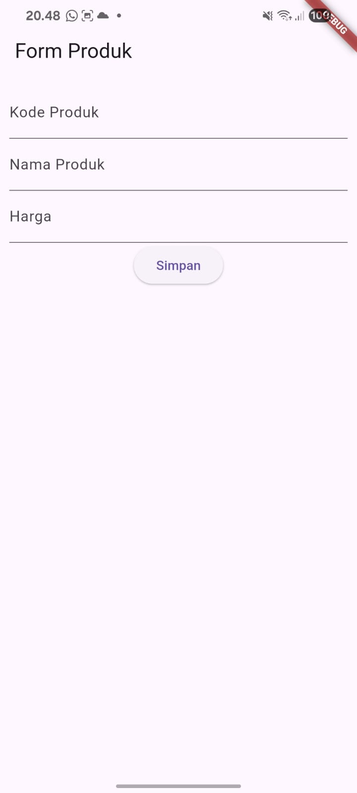

# 📱 Laporan Praktikum Pemrograman Mobile - Flutter

**Data Praktikan**
- **Nama** : [Alifvia Putri Dewani]
- **NIM** : [H1D024131]
- **Shift KRS** : [Shift B]
- **Shift Akhir** : [Shift E]
---

## 📄 Tugas Pertemuan 1: Bahasa Pemrograman Dart
**Tanggal Pelaksanaan:** 21 Oktober 2026

### 📌 Ringkasan Kegiatan
- **Aspek Non-Teknis:** Mempelajari konsep dasar bahasa pemrograman Dart sebagai fondasi utama dalam membangun aplikasi lintas platform pada framework Flutter. Pembahasan meliputi alur logika dasar, OOP, penanganan eksepsi, serta eksekusi asinkronus.
- **Aspek Teknis:** 
  - Pengujian sintaks secara online menggunakan [DartPad](https://dartpad.dev).
  - Penggunaan variasi tipe data (`int`, `double`, `String`, `bool`, `var`), operasi aritmatika, dan operasi logika.
  - Penerapan struktur kendali, pengulangan, serta modularisasi fungsi.
  - Pembuatan Class & Object, statement `import`, penanganan `try-catch`, dan fungsi `async`/`await`.

> **Kesimpulan Sesi 1:** Sesi ini memberikan pemahaman inti mengenai arsitektur bahasa Dart sebelum menyusun antarmuka visual Flutter.

---

## 📝 Tugas Pertemuan 2: Widget & Design Flutter
**Tanggal Pelaksanaan:** Rabu, 28 Oktober 2026

### 📌 Ringkasan Kegiatan
- **Aspek Non-Teknis:** Memahami arsitektur folder proyek Flutter, pemisahan file UI, serta prinsip tata letak antarmuka aplikasi seluler.
- **Aspek Teknis:**
  - Konfigurasi `Scaffold` dan `AppBar` dengan warna latar biru serta teks tebal.
  - Penerapan layout vertikal (`Column`) dan horizontal (`Row`).
  - Pembuatan form input data (`TextField` & `TextEditingController`) serta navigasi antar halaman (`Navigator.push`) dari `ProdukForm` ke `ProdukDetail`.
  - Penyajian daftar produk responsif menggunakan kombinasi `ListView`, `Card`, dan `ListTile`.

### 📸 Tangkapan Layar Hasil Praktikum

> **Kesimpulan Sesi 2:** Sesi kedua ini berhasil memberikan pemahaman praktis mengenai komponen widget dasar Flutter, interaksi form, perpindahan halaman, dan pembuatan layout daftar produk.