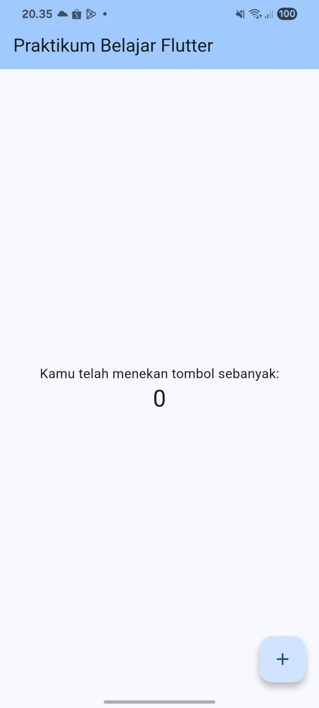
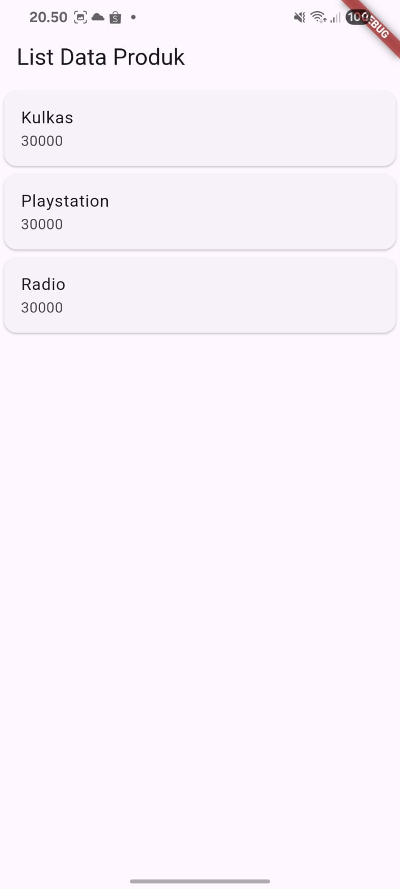
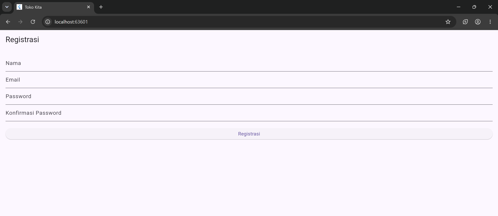
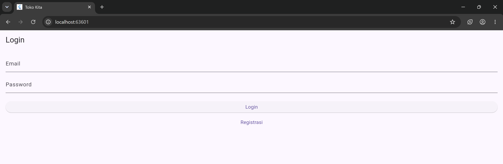
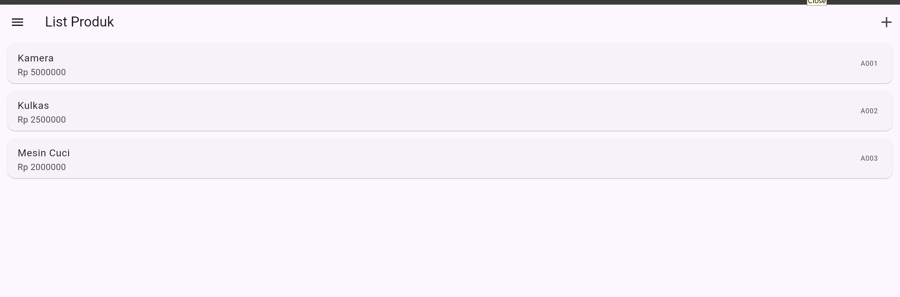
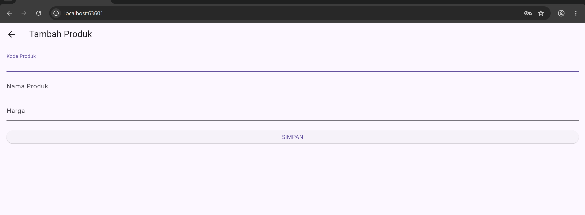
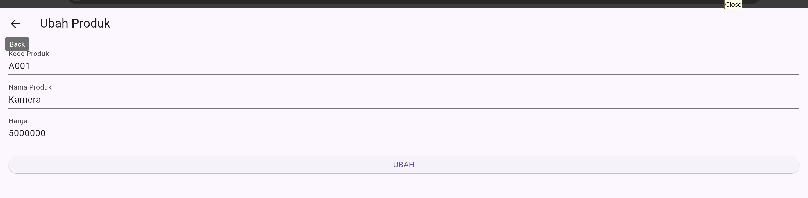
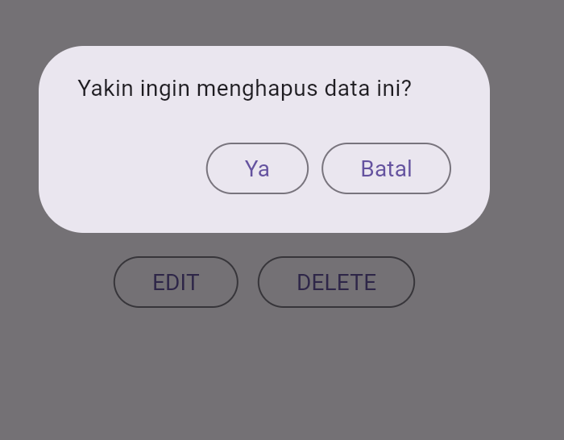

# 📱 Laporan Praktikum Pemrograman Mobile - Flutter

**Data Praktikan**
- **Nama** : Alifvia Putri Dewani
- **NIM** : H1D024131
- **Shift KRS** : Shift B
- **Shift Akhir** : Shift E

---

## 📄 Tugas Pertemuan 1: Bahasa Pemrograman Dart
**Tanggal Pelaksanaan:** 21 Oktober 2026

### 📌 Ringkasan Kegiatan
- **Aspek Non-Teknis:** Mempelajari konsep dasar bahasa pemrograman Dart sebagai fondasi utama dalam membangun aplikasi lintas platform pada framework Flutter. Pembahasan meliputi alur logika dasar, OOP, penanganan eksepsi, serta eksekusi asinkronus.
- **Aspek Teknis:** 
  - Pengujian sintaks secara online menggunakan [DartPad](https://dartpad.dev).
  - Penggunaan variasi tipe data (`int`, `double`, `String`, `bool`, `var`), operasi aritmatika, dan operasi logika.
  - Penerapan struktur kendali, pengulangan, serta modularisasi fungsi.
  - Pembuatan Class & Object, statement `import`, penanganan `try-catch`, dan fungsi `async`/`await`.

> **Kesimpulan Sesi 1:** Sesi ini memberikan pemahaman inti mengenai arsitektur bahasa Dart sebelum menyusun antarmuka visual Flutter.

---

## 📝 Tugas Pertemuan 2: Widget & Design Flutter
**Tanggal Pelaksanaan:** Rabu, 28 Oktober 2026

### 📌 Ringkasan Kegiatan
- **Aspek Non-Teknis:** Memahami arsitektur folder proyek Flutter, pemisahan file UI, serta prinsip tata letak antarmuka aplikasi seluler.
- **Aspek Teknis:**
  - Konfigurasi `Scaffold` dan `AppBar` dengan warna latar biru serta teks tebal.
  - Penerapan layout vertikal (`Column`) dan horizontal (`Row`).
  - Pembuatan form input data (`TextField` & `TextEditingController`) serta navigasi antar halaman (`Navigator.push`) dari `ProdukForm` ke `ProdukDetail`.
  - Penyajian daftar produk responsif menggunakan kombinasi `ListView`, `Card`, dan `ListTile`.

### 📸 Tangkapan Layar Hasil Praktikum

> **Kesimpulan Sesi 2:** Sesi kedua ini berhasil memberikan pemahaman praktis mengenai komponen widget dasar Flutter, interaksi form, perpindahan halaman, dan pembuatan layout daftar produk.

---

## 🔑 Tugas Pertemuan 3: Routes, Side Menu, Login & Local Storage
**Tanggal Pelaksanaan:** Rabu, 04 November 2026

### 📌 Ringkasan Kegiatan
- **Aspek Non-Teknis:** Memahami alur autentikasi pengguna pada aplikasi seluler, manajemen status login, alur navigasi antarhalaman (*routing*), serta prinsip penyimpanan data lokal (*local storage*).
- **Aspek Teknis:**
  - Penggunaan package `shared_preferences` untuk menyimpan dan membaca data `username` secara persisten pada local storage[cite: 5, 6, 11].
  - Pembuatan formulir `LoginPage` menggunakan `StatefulWidget` dengan validasi kredensial serta pembuatan dialog pop-up `AlertDialog` (`_showDialog`)[cite: 6, 7, 8].
  - Integrasi komponen `Drawer` (`Sidemenu`) yang dapat diakses di beberapa halaman (`HomePage` dan `AboutPage`) menggunakan `ListTile` dan `Navigator.push`[cite: 11, 12, 13, 14].
  - Menampilkan data profil pengguna secara dinamis di `HomePage` menggunakan fungsi `_loadUsername()` yang mengambil data dari local storage[cite: 11].

### 📸 Tangkapan Layar Hasil Praktikum

> **Kesimpulan Sesi 3:** Sesi ketiga ini berhasil mengimplementasikan sistem autentikasi sederhana berbasis `shared_preferences` dan navigasi antarhalaman menggunakan komponen `Drawer`.

---

## 🛒 Tugas Pertemuan 4: Integrasi REST API (CodeIgniter 4) & CRUD Produk
**Tanggal Pelaksanaan:** Rabu, 11 November 2026

### 📌 Ringkasan Kegiatan
- **Aspek Non-Teknis:** Memahami arsitektur komunikasi *client-server* menggunakan REST API, pertukaran data berformat JSON, konfigurasi *Cross-Origin Resource Sharing* (CORS), serta alur autentikasi dan manajemen data dinamis berbasis database MySQL.
- **Aspek Teknis:**
  - Pembuatan *backend* REST API menggunakan **CodeIgniter 4** dengan database MySQL (`toko_api`) yang terdiri dari tabel `member`, `member_token`, dan `produk`.
  - Implementasi *endpoint* autentikasi **Registrasi** (`POST /registrasi`) dengan enkripsi `password_hash` serta **Login** (`POST /login`) yang menghasilkan token sesi `auth_key`.
  - Penggunaan package `http` dan fungsi `jsonDecode` pada Flutter untuk melakukan *HTTP request* (`GET`, `POST`, `PUT`, `DELETE`) ke *endpoint* server lokal (`toko-api`).
  - Implementasi lengkap fitur **CRUD Produk** (*Create, Read, Update, Delete*) secara asinkronus (`FutureBuilder`, `async`/`await`) meliputi halaman `ProdukPage` (List Produk), `ProdukForm` (Tambah & Ubah Produk), dan `ProdukDetail` (Detail & Hapus Produk dengan konfirmasi `AlertDialog`).

### 📸 Tangkapan Layar Hasil Praktikum

> **Kesimpulan Sesi 4:** Sesi keempat ini berhasil mengintegrasikan aplikasi Flutter dengan backend REST API CodeIgniter 4 dan database MySQL sehingga seluruh proses autentikasi serta operasi CRUD data produk dapat berjalan secara dinamis dan persisten.